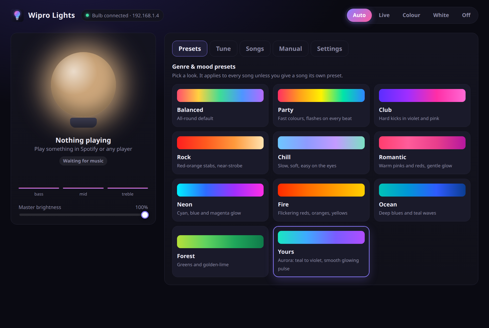
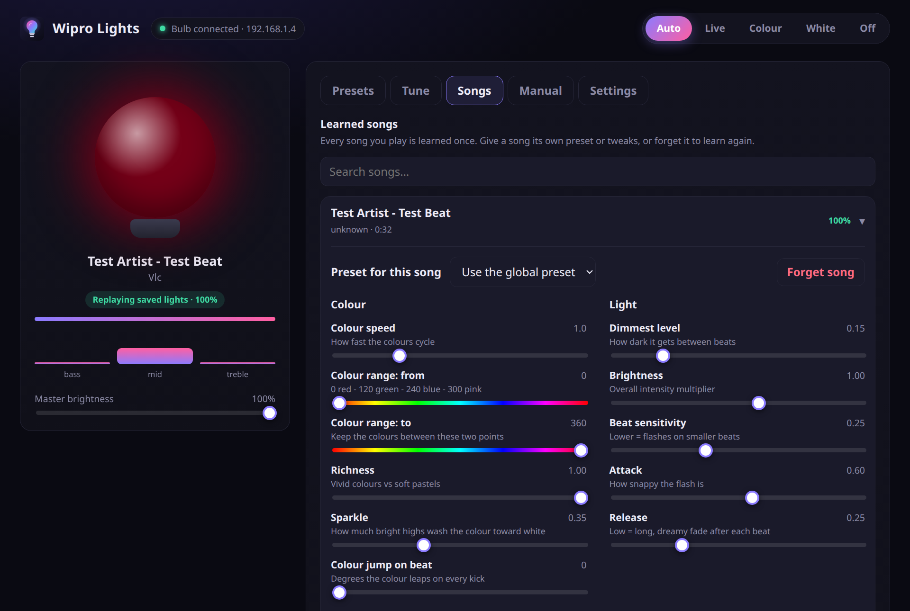
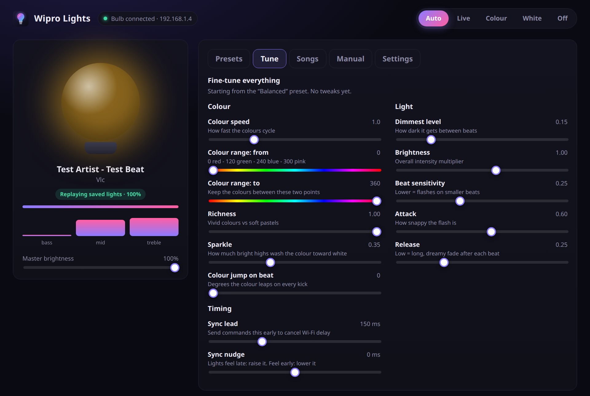
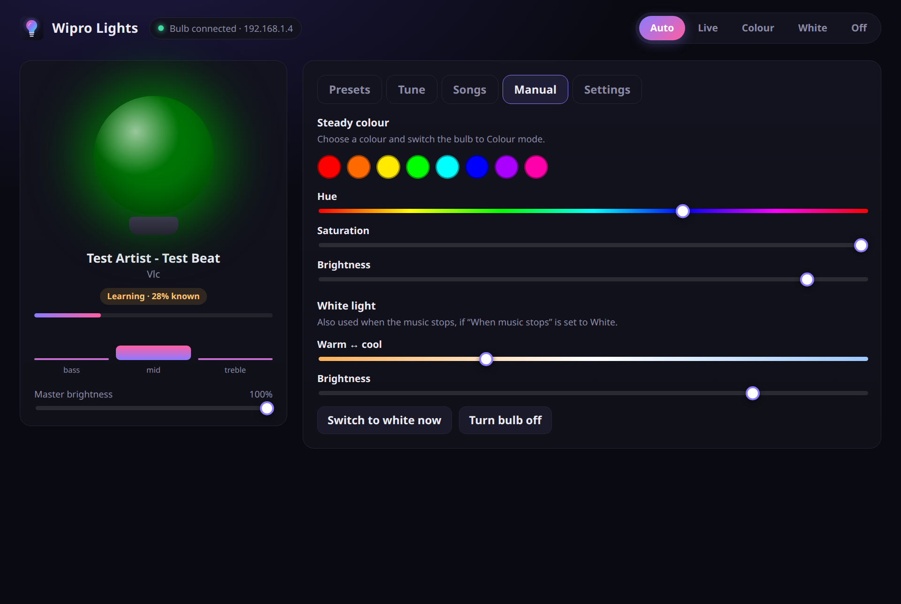
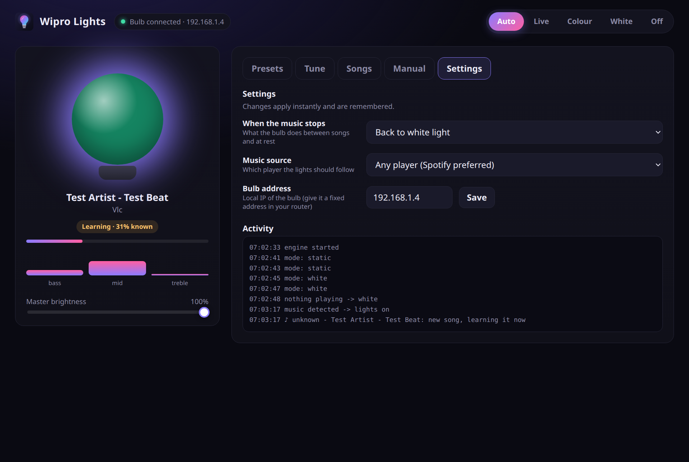

# 💡 Wipro Lights

**Sync a Wipro / Tuya Wi-Fi smart bulb to the music playing on your Linux laptop, with a real app, not a script.**

It listens to whatever your computer is playing (Spotify, VLC, a browser tab, anything), turns the sound into colour, and sends it to your bulb over your **local network**. No cloud, no phone, no microphone.

<p align="center">
  
</p>

## ✨ What makes it different

| | |
|---|---|
| 🧠 **Learns each song once** | The first time a song plays, its loudness pattern (bass / mid / treble, every 32 ms) is saved. From then on the lights are driven from the saved data, **read ahead of the playhead**, so they land on the beat with no Wi-Fi lag. |
| 🎛 **A proper UI** | A dark dashboard with a live orb that mirrors the real bulb, now-playing, learning progress and live bass/mid/treble meters. |
| 🎨 **10 genre & mood presets + yours** | Balanced, Party, Club, Rock, Chill, Romantic, Neon, Fire, Ocean, Forest, plus a **Yours** slot you define in `presets.py`. One click, applies instantly. |
| 🎚 **13 tuning knobs** | Colour range, speed, richness, beat sensitivity, attack/release, brightness floor, sync timing and more. Tune globally or **per song**. |
| 🚀 **Runs in the background** | A systemd user service that starts at login and restarts itself if it ever crashes. Open the app from your app menu like any other program. |
| 🔒 **Private by design** | Everything stays on your machine. Only band-loudness numbers are saved, never the audio. |

## 📸 Tour

### Replay mode: saved lights, tuned per song


Every learned song shows how much of it is known. Give any song its own preset or tweak individual knobs, or forget it to learn it again.

### Tune everything


Each slider shows the value in effect and a **reset** link appears once you've changed it. "Reset to preset" clears all your tweaks.

### Manual colours and white light


### Settings and activity log


Choose what the bulb does when the music stops (white / off / stay as it is), restrict to one player such as Spotify, and set the bulb's IP.

## 🧰 Requirements

- **Linux with PipeWire** (the default on Ubuntu 22.10+). Audio is captured from the speaker output with `pw-record`.
- A **media player that supports MPRIS** (Spotify, VLC, Firefox, Chrome and most others do). It tells the app which song is playing and where you are in it.
- **Python 3.10+**
- A **Tuya-based Wi-Fi bulb** (Wipro, Syska, Havells Smart, Philips-white-label...) that speaks the Tuya **v3.5** local protocol, paired with the **Smart Life** app.
- Google Chrome / Chromium is optional. It gives you a native-looking app window; otherwise the default browser is used.

> Tested with a Wipro 9 W B22 Wi-Fi LED bulb. Other Tuya bulbs usually work, but datapoint numbers can differ (see *Other bulbs*).

## 🚀 Setup

### 1. Get the code and install dependencies

```bash
git clone <your-repo-url> wipro-lights
cd wipro-lights
python3 -m venv .venv
.venv/bin/pip install -r requirements.txt
```

### 2. Get your bulb's local key (one time)

Tuya devices are controlled locally with a per-device key. You get it once from the free Tuya developer portal:

1. Pair the bulb in the **Smart Life** app.
2. Create a free project at [iot.tuya.com](https://iot.tuya.com) (Cloud → Development), link your Smart Life account to it by scanning the QR code, and copy the project's **Access ID** and **Access Secret**.
3. Run TinyTuya's wizard, which writes `devices.json` for you:

   ```bash
   .venv/bin/python -m tinytuya wizard
   ```

4. Find the bulb's IP address on your network:

   ```bash
   .venv/bin/python -m tinytuya scan
   ```

   Give the bulb a **fixed IP in your router** (DHCP reservation) so it never changes.

See [`devices.example.json`](devices.example.json) for the shape of the file.

> ⚠️ `devices.json` contains your bulb's secret key. It is in `.gitignore`. **Never commit it.**

### 3. Install the app

```bash
./lights install
```

This sets up a background service that starts at login, adds **Wipro Lights** to your app menu with its own icon, and starts everything now. Then open the app from the menu, or:

```bash
./lights ui
```

In **Settings → Bulb address**, enter your bulb's IP and press *Save*.

Optional: put the launcher on your PATH so `lights` works anywhere:

```bash
ln -s "$PWD/lights" ~/.local/bin/lights
```

## 🎵 Using it

1. Leave the mode on **Auto**.
2. Play a song in Spotify (or anything). The orb lights up, the tag says **Learning**, and the bulb follows the music live.
3. Play the same song again, and the tag says **Replaying saved lights**. The lights are now perfectly timed.
4. Pause, and the bulb goes back to white (or off, your choice).

### Modes

| Mode | What it does |
|---|---|
| **Auto** | Reacts to music and learns every new song so replays are perfectly timed. |
| **Live** | Reacts to the music only, saves nothing. |
| **Colour** | One steady colour you pick in the *Manual* tab. |
| **White** | Plain white light with your warm/cool and brightness setting. |
| **Off** | Bulb off. |

### How the layers combine

```
built-in defaults  <  global preset  <  your global tweaks  <  a song's preset  <  a song's tweaks
```

Pick *Party* for everything, then give one slow song *Chill*. Set a favourite's *Sync nudge* if the lights feel a hair early or late.

## ⌨️ Command line (optional)

Everything is in the UI, but there are shortcuts:

```text
lights ui                  open the app window
lights install | uninstall set up / remove the background service and menu icon
lights start | stop | restart | status | logs
lights on | off | white    quick control
lights color <name>        red green blue purple pink orange yellow cyan
lights preset <name>       party club rock chill romantic neon fire ocean forest balanced
lights mode <name>         auto live static white off
lights now                 what's playing and how much of it is learned
lights tracks              list learned songs
lights set <song> hue_min=0 hue_max=60 preset=fire    tweak one song  (reset = clear)
lights forget <song>       delete a song's data so it is learned again
lights run                 run the service in the foreground (debugging)
```

## 🔬 How it works

```
 audio playing ──► PipeWire monitor ──► 32 ms FFT frames ──► bass / mid / treble levels
                                                                  │
 Spotify / VLC ──► MPRIS (title, position) ──► song identity ─────┤
                                                                  ▼
            first play: record levels by song position ◄── learn ─┤
            later plays: read levels AHEAD of the playhead ◄─ replay
                                                                  ▼
                              colour mapping (preset + tweaks) ──► Tuya local protocol ──► 💡
```

- **Why replay is better than live:** a live analyser can only react to sound that already happened, and Wi-Fi adds more delay on top. A saved song can be read slightly *into the future*, so commands arrive when the beat does.
- **Self-healing connection:** Tuya bulbs answer every command; if those replies pile up unread the connection jams. The app drains replies, sends keep-alives, and reconnects automatically if the bulb goes quiet.
- **One owner for the bulb:** the bulb allows a single local connection, so the background service owns it and the UI and CLI talk to the service.

### Project layout

```text
service.py     background process: engine + web UI + local API (127.0.0.1:8765)
autolight.py   the engine: MPRIS, audio capture, learn / replay, song files
music.py       audio -> colour mapping and the default knob values
presets.py     the genre presets and the list of tuning knobs (the UI is generated from this)
config.py      persistent settings and the layering of presets / tweaks
bulb.py        Tuya connection with self-healing and keep-alive
lights.py      command line + installer       lights   launcher script
ui/            index.html (the whole front end) and icon.svg
tracks/        learned songs (created at runtime, git-ignored)
```

## 🔐 Security notes

- The UI and API listen on **127.0.0.1 only**. Changes need a custom header and a matching `Host`, so other websites you visit can't control your bulb.
- `devices.json` (the bulb key), `config.json` and `tracks/` are git-ignored. If you ever published your Tuya **Access Secret**, regenerate it in the Tuya console.

## 🧩 Other bulbs

The colour datapoint (`24`, a 12-character hex string `HHHHSSSSVVVV`), mode (`21`), power (`20`), brightness (`22`) and temperature (`23`) are for the Wipro B22 firmware. A different bulb may use other numbers or the older `colour_data` (dp 5). Check yours with `.venv/bin/python -m tinytuya wizard` output (`mapping` in `devices.json`) and adjust `bulb.py`.

## 🛠 Troubleshooting

| Problem | Try |
|---|---|
| UI says **Bulb not answering** | Check the IP in *Settings*, make sure the bulb is on Wi-Fi, and close the Smart Life app (some bulbs allow only one connection). Then `lights logs`. |
| Lights don't react | Play something. The tag should say *Live sync* or *Learning*. Check `pw-record --help` works and the volume isn't muted. |
| Lights feel late / early | Tune → *Sync nudge* (raise if late). Per song: Songs → open the song. |
| It follows the wrong player | Settings → *Music source*. |
| Start over for one song | Songs → *Forget song*. |
| See what the service is doing | `lights logs` or the *Settings → Activity* panel. |

## Uninstall

```bash
./lights uninstall
```

Removes the service and menu icon. Your songs and settings stay in the folder until you delete it.
